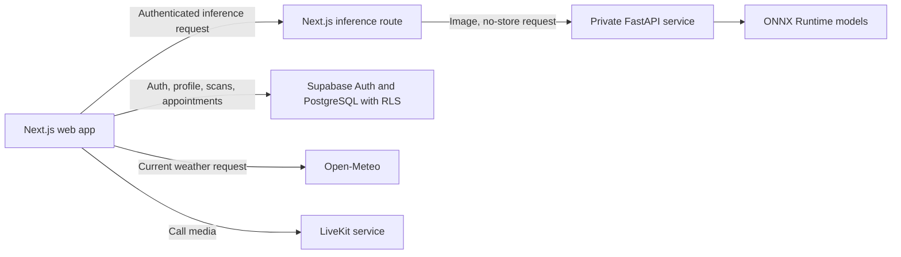
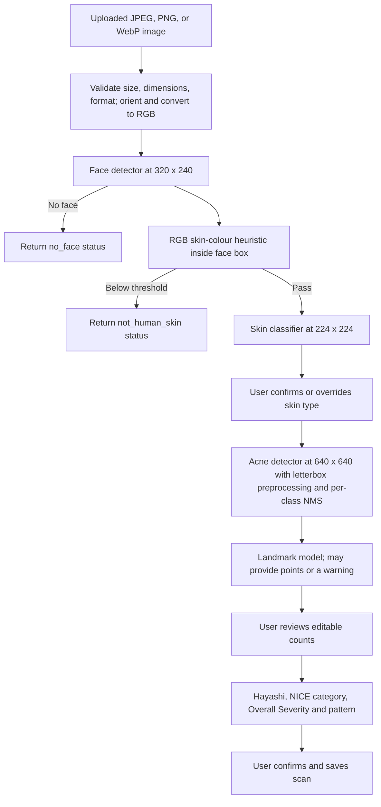

# SkinWISE

**AI-assisted skin analysis and dermatologist consultation platform**

Final Year Project, Faculty of Computing, Riphah International University

SkinWISE combines a Next.js web application, a private FastAPI inference service, ONNX models, and Supabase. Users can submit a face image for skin-type and acne-lesion analysis, review lesion counts, view a rule-based skincare routine, and manage dermatologist appointments. Confirmed scan summaries can be saved to scan history. The application is an academic project and does not provide a medical diagnosis.

## 1. Project overview

The project brings image-based skin analysis and remote dermatologist consultations into one web application. The analysis workflow provides model outputs and a transparent, user-reviewable severity calculation. Appointment features support patient and doctor workflows, messaging, and audio/video consultations.

## 2. Problem statement

People seeking basic skin-care information may have difficulty interpreting visible skin concerns or finding a convenient route to a dermatologist. SkinWISE explores how computer vision, explainable rule-based guidance, scan history, and appointment tools can be combined in an academic prototype. Its automated analysis is not a substitute for professional assessment.

## 3. Project objectives

- Classify facial skin type as dry, normal, or oily.
- Detect four acne lesion classes and present annotated results.
- Let users review lesion counts before severity is calculated and saved.
- Provide rule-based routine guidance with reasons and optional weather context.
- Support user accounts, scan history, dermatologist appointments, messaging, and calls.
- Keep model inference behind an authenticated application proxy and apply Supabase row-level policies to user data.

## 4. Key features

- Email/password authentication and optional Google OAuth through Supabase Auth.
- Image upload and browser camera capture.
- Face and skin-colour checks before skin-type classification.
- Skin-type prediction with user confirmation or override.
- Acne detection, annotated image, editable lesion counts, and explicit review before saving when detections exist.
- Hayashi- and NICE-related count calculations combined by a documented SkinWISE rule.
- Routine recommendations, explanations, optional Open-Meteo context, and a client-generated PDF report.
- Scan history, trend chart, deletion controls, and comparison with a previous scan.
- Self-reported Safety Profile and one-time onboarding.
- Patient/doctor appointment workflows, appointment chat with optional file attachments, and LiveKit audio/video calls.
- Separate Admin and Doctor dashboards.
- Consultation payment and refund records are **simulated for demonstration**; the application does not transfer money or integrate with a real payment gateway.

## 5. System architecture



The inference proxy checks the Supabase user session before forwarding either inference stage. The FastAPI routes do not implement their own user authentication, so the deployment should keep the inference service reachable only from the trusted Next.js server/network. Inference responses are marked `no-store`; the backend code decodes images in memory and does not write uploaded images to disk. Scan records store summary fields and JSON snapshots, not the original uploaded photo. Chat attachments are a separate feature stored in Supabase Storage.

## 6. Technologies and tools

| Layer | Technologies |
|---|---|
| Web application | Next.js 14, React 18, TypeScript, Tailwind CSS |
| Inference service | Python, FastAPI, Uvicorn, Pillow, NumPy |
| Model runtime | ONNX Runtime (CPU execution provider) |
| Authentication and data | Supabase Auth, PostgreSQL, Row Level Security, Supabase Storage |
| Calls | LiveKit client and server SDKs |
| Weather | Browser geolocation and Open-Meteo Forecast API |
| Report export | jsPDF |

Dependency versions and ranges are maintained in `package.json` and `backend/requirements.txt`.

## 7. AI models and image-processing pipeline

The FastAPI service loads four ONNX files from `backend/models/` during application startup. A missing required model prevents the service from starting successfully.



| Model file | Use in current backend |
|---|---|
| `face_detector.onnx` | Face-box detection; resized to 320×240, normalized as `(pixel - 127) / 128`; confidence threshold 0.70 and face-box NMS IoU 0.40. |
| `skinwise_mobilenetv2.onnx` | Dry/normal/oily classification; 224×224 RGB, ImageNet mean/std normalization, NCHW tensor, CPU ONNX Runtime. |
| `acne_detector.onnx` | Four-class lesion detection; 640×640 letterboxed RGB input, confidence threshold 0.35 and per-class NMS IoU 0.45. |
| `landmark_detector.onnx` | Facial landmark inference used to suggest a left/right split for papules and pustules; manual count entry remains possible if landmark inference fails. |

The backend accepts JPEG, PNG, and WebP, limits uploads to 12 MiB and images to 25 megapixels, applies EXIF orientation, and converts inputs to RGB. Acne boxes and counts are model suggestions; users can correct counts before scoring. The skin-colour heuristic is a screening rule and does not establish that an image is a person or guarantee demographic fairness.

## 8. Skin-type classification

The current backend explicitly loads `skinwise_mobilenetv2.onnx`. It resizes the full input image to 224×224 RGB, scales values to `[0,1]`, applies ImageNet channel means and standard deviations, and transposes to `[1,3,224,224]`. The output scores are converted to probabilities over `dry`, `normal`, and `oily` in that order.

The result screen lets users keep the predicted type or select another. The quiz implementation exists in `lib/skinQuiz.ts` and `components/SkinTypeQuiz.tsx`, but the current scan confirmation component uses direct selection; the quiz is not part of the active scan flow shown by `components/ScannerApp.tsx` and `components/ConfirmSkinType.tsx`.

## 9. Acne detection and severity assessment

The detector returns boxes for `comedone`, `nodules`, `papules`, and `pustules`. The interface overlays the boxes and initializes editable count fields. If detections exist, the user must mark the counts reviewed before the save control is enabled. The reviewed values, rather than raw detector values, feed the severity and pattern functions.

The calculation implemented in `lib/hayashi.ts`, `lib/nice.ts`, and `lib/overallSeverity.ts` is:

- **Hayashi signal:** sum papules and pustules separately on each half-face; use the higher half count. Zero maps to Clear in the application, 1–5 to Mild, 6–20 to Moderate, and above 20 to Severe. The cited published ranges are 0–5, 6–20, and 21–50; the application maps counts over 50 to its Severe tier.
- **NICE category:** whole-face inflammatory count is papules + pustules + nodules. The implementation returns Mild-to-Moderate below 35 lesions and fewer than 3 nodules; otherwise it returns Moderate-to-Severe.
- **Nodule tier:** SkinWISE design rule of zero = Clear, one = Mild, two = Moderate, and three or more = Severe.
- **Overall Severity:** use the higher of the Hayashi signal and nodule tier; if any lesion is confirmed, Clear is raised to at least Mild; NICE Moderate-to-Severe raises the result to Severe. This combined rule is a SkinWISE design choice, not a separately validated clinical scale.
- **Acne pattern:** a code-defined comparison of confirmed comedonal and inflammatory counts (nodules are counted as inflammatory for this pattern) yields Clear, Comedonal-dominant, Inflammatory-dominant, or Mixed. This is an application-defined classification.

The code cites Hayashi (2008) and NICE NG198 (2021); this README describes the implemented calculations, not an independent verification of the clinical literature. Landmark midline splitting is an approximation selected by the project. In the UI, the primary severity display is Overall Severity; method-specific values are not shown as separate dashboard badges.

## 10. Recommendation engine

`lib/routineEngine.ts` implements deterministic rules rather than a generative model. It uses confirmed skin type, acne pattern, Overall Severity, optional weather, and Safety Profile flags. It provides cleanser, moisturizer, sunscreen, and acne-care ingredient information with explanatory text. Ingredient suggestions are informational and are not prescriptions.

The implemented rules include single-agent guidance for Mild, combination guidance for Moderate, and withholding acne-care ingredients with professional-evaluation messaging for Severe. Dry skin changes some ingredient choices. Cleanser, moisturizer, and sunscreen suggestions are practical application heuristics. The combined grading and routine rules have not been independently clinically validated.

## 11. Weather integration and Safety Profile

Weather is optional. `lib/weather.ts` requests browser geolocation and fetches current temperature, relative humidity, and UV index from Open-Meteo. If location permission is declined or the request fails, the scan can continue without weather context. Coordinates are used to form a short location label in the client response.

The Safety Profile stores self-reported flags for pregnancy/breastfeeding, isotretinoin use, open wound/infection, known active allergy, and age under 15. The profile can be completed or skipped during first-use onboarding and edited later. In current code, any active flag pauses the **entire personalized routine** (cleanser, moisturizer, sunscreen, and acne-care recommendations); image analysis itself continues. The saved scan records the pause state and reasons. This is a broad eligibility rule, not an ingredient-specific clinical assessment.

## 12. Database design and security

`supabase/schema.sql` defines the core `profiles` and `scans` tables. Consultation and call data are introduced through migrations. Tables include user profile/onboarding/safety fields, scan summaries, doctors, appointments, appointment messages, call sessions, and demonstration payment/refund records. Chat attachment support also requires the attachment migration and its Supabase Storage bucket/policies.

The checked-in SQL enables RLS and scopes profile and scan access to the authenticated owner. Consultation, chat, call-session, and payment migrations define additional policies, grants, and database functions. Admin and Doctor pages also check membership on the server. Server-side call routes use a service-role client for privileged lifecycle operations; the service-role key must remain server-only. The public Supabase URL and anon key are used by browser/server clients and are not substitutes for the service role key.

These statements describe checked-in source. The repository cannot establish which migrations are applied to a particular Supabase project or whether its live policies/storage settings match this code. Review `SECURITY-REVIEW.md` for previously recorded static-review findings and verification limits. Do not expose the FastAPI service publicly without adding and validating an appropriate access-control boundary.

## 13. Patient consultation and appointment system

Patients can browse active doctors, request appointments, review appointment status, and use appointment messaging when the appointment is eligible. The doctor workflow supports appointment review and management. Appointment slots use database-side availability helpers and the 15-minute slot migration. The exact behavior of an existing deployment depends on its applied migration set.

Appointment chat supports text and optional JPG, PNG, WebP, GIF, or PDF attachments, with a client-side 10 MiB limit and Supabase Storage integration. The attachment migration defines the bucket and access policies; apply it only after the relevant consultation and chat schema is installed. Database policy and storage configuration should be checked in the target project.

Consultation payment screens and records are demo-only. Statuses such as `simulated_paid` and `simulated_refunded` do not represent an external transaction, settlement, or actual refund. The UI labels the demo payment choices accordingly.

## 14. LiveKit video and audio consultation

For confirmed appointments with a linked doctor account, participants can initiate audio or video calls, receive and accept/reject invitations, join a two-participant LiveKit room, control microphone/camera, and end calls. Next.js server routes authorize participants against the appointment, create/manage room sessions, and issue expiring LiveKit access tokens. Browser media requires user permission and a working LiveKit deployment.

Live calling requires server credentials and a browser-reachable LiveKit URL. The README does not imply that a LiveKit deployment is provisioned or tested for this project.

## 15. Admin and Doctor dashboards

- **Admin (`/admin`):** access is checked against `admin_users`. The dashboard manages doctors and appointments and includes demo payment/refund administration where the corresponding migrations have been applied. Admin membership must be provisioned by a trusted administrator through Supabase; it is not self-selected in the user interface.
- **Doctor (`/doctor`):** access is checked against a doctor record linked to the authenticated user. The dashboard provides appointment views, appointment chat, call actions, feedback, and relevant consultation/payment status where configured.
- **Patient (`/consultations`):** authenticated patient-facing doctor directory, booking, appointment, chat, call, and demo-payment workflows.

## 16. Installation and setup

### Prerequisites

- Node.js compatible with the installed Next.js 14 project (Node.js 18.17 or later is suitable).
- Python 3.10 or later and `pip`.
- A Supabase project for authentication and database features.
- Optional: Google OAuth provider configuration, LiveKit service, and a Supabase Storage setup for chat attachments.

### Install dependencies

From the repository root:

```powershell
npm install
py -m venv backend\.venv
backend\.venv\Scripts\Activate.ps1
python -m pip install -r backend\requirements.txt
```

### Configure Supabase and migrations

1. Create a Supabase project and configure its Auth redirect URLs for the local application.
2. Run `supabase/schema.sql` in the Supabase SQL Editor for a fresh database.
3. Apply only the migrations needed for the features you will use, following their dependencies. For consultation and chat, use this order:
   - Run `migration_add_consultations.sql` after `schema.sql`.
   - For text-only chat, run `migration_add_appointment_chat.sql` after consultations.
   - For chat attachments, either run `migration_add_appointment_chat_attachments.sql` directly after consultations, or run it after `migration_add_appointment_chat.sql` to upgrade existing text-only chat. The attachment migration must follow consultations in either path. Do not rerun the text-only chat migration after attachment support is installed.
   - If required by the existing database's policy state, run `migration_fix_appointment_chat_rls_recursion.sql` after the attachment migration.

   Other consultation features have their own prerequisites stated in their SQL headers. For example, `migration_add_appointment_patient_information.sql` follows both consultations and doctor appointment archive; `migration_add_15_minute_appointment_slots.sql` follows consultations. Payment, feedback, cancellation, archive, and call-session migrations should likewise be checked individually before application. Existing databases may also require severity, safety-profile, and onboarding migrations. Read each migration and compare it with the actual schema state before applying it.
4. Do not rerun historical migrations blindly on an existing database. Compare its applied schema with the migration contents and back it up before schema changes.
5. Provision admin and doctor records through a trusted database administrator. Link a doctor record to the appropriate Supabase Auth user to enable the Doctor dashboard.

### Run the application

Start the FastAPI service in one terminal:

```powershell
backend\.venv\Scripts\Activate.ps1
python -m uvicorn app.main:app --app-dir backend --host 127.0.0.1 --port 8000 --reload
```

Check `http://127.0.0.1:8000/health` for service status. In another terminal, start Next.js:

```powershell
npm run dev
```

Open `http://localhost:3000`. The root route shows a public landing page to signed-out visitors. Scanning and account features require sign-in. Camera and geolocation behavior depend on browser permissions; camera access generally requires localhost or HTTPS.

For a production frontend build, the repository scripts are:

```powershell
npm run build
npm run start
```

Deploy FastAPI separately on a private/restricted network and set its URL on the Next.js server. The repository does not include deployment manifests or define a production hosting topology.

## 17. Environment variables

Create a local environment file from these **names and placeholders**. The repository has no root `.env.local.example`; never commit real credentials. Only the Supabase URL and anon key are intended for browser client configuration. Keep service-role and LiveKit secrets server-side.

| Variable | Purpose | Safe placeholder example |
|---|---|---|
| `NEXT_PUBLIC_SUPABASE_URL` | Supabase project URL used by Auth and database clients. | `https://your-project.supabase.co` |
| `NEXT_PUBLIC_SUPABASE_ANON_KEY` | Supabase anon/public client key; configure RLS correctly. | `your-supabase-anon-key` |
| `SUPABASE_SERVICE_ROLE_KEY` | Server-only privileged operations, including call lifecycle operations. | `your-server-only-service-role-key` |
| `SKINWISE_API_URL` | Server-side base URL for the FastAPI inference service; defaults to local port 8000. | `http://127.0.0.1:8000` |
| `SKINWISE_MODEL_DIR` | Optional FastAPI model directory override; defaults to `backend/models`. | `./backend/models` |
| `LIVEKIT_API_KEY` | Server-side LiveKit API key for room/token operations. | `your-livekit-api-key` |
| `LIVEKIT_API_SECRET` | Server-only LiveKit API secret. | `your-livekit-api-secret` |
| `NEXT_PUBLIC_LIVEKIT_URL` | LiveKit WebSocket URL used by browser clients; preferred over `LIVEKIT_URL` when set. | `wss://your-livekit-host` |
| `LIVEKIT_URL` | Optional server-side LiveKit URL fallback. | `https://your-livekit-host` |

Open-Meteo does not require an API key. Google OAuth credentials are configured with Supabase Auth; the application source does not define separate Google environment variables.

## 18. Testing and results

The root `package.json` provides `dev`, `build`, `start`, and `lint` scripts. `backend/requirements.txt` defines backend dependencies. No dedicated application test suite or reproducible model evaluation report was identified in the audited root project. Therefore this README makes no claims about model accuracy, clinical validation, benchmark performance, or passing test results. Any FYP results section should report the dataset, split, evaluation protocol, metrics, and hardware used, based on actual project records.

## 19. Known limitations

- The repository does not document model training data, training procedure, or measured accuracy metrics.
- Model scores and lesion boxes are fallible; user review reduces reliance on raw counts but does not validate the model output.
- The face and RGB skin-colour gates are heuristics and may reject valid images or accept unsuitable ones.
- Landmark failure prevents automatic left/right prefill; the user must enter/review counts manually.
- The Hayashi/NICE combination, nodule tier, pattern classification, and routine decision rules are application design choices and have not been independently clinically validated.
- The skin-type quiz is implemented but is not shown as an active step in the current scan confirmation flow.
- Weather depends on user permission and network access. Routine saving may proceed without weather.
- The Safety Profile is self-reported and uses a broad whole-routine pause rule; it is not a medical safety assessment.
- Payment and refund flows are simulated; no real funds are processed.
- Live Supabase migration state, live RLS/storage configuration, LiveKit provisioning, and deployed network controls cannot be confirmed from source alone.
- The inference service itself has no user authentication; it relies on network isolation and the authenticated Next.js proxy.

## 20. Future enhancements

Potential future work, subject to project scope and validation, includes publishing a reproducible model evaluation, adding clinically reviewed and demographically diverse validation data, integrating genuine model explainability, connecting a real payment provider with required compliance controls, and adding automated integration tests for database policies and call lifecycles.

## 21. Project structure

```text
app/                         Next.js pages, auth routes, and server API routes
  api/inference/              Authenticated inference proxy
  api/call-sessions/          LiveKit call-session lifecycle and token routes
components/                  Scanner, dashboards, consultations, chat, and UI
lib/                         Inference clients, grading, routines, Supabase, LiveKit
  call-sessions/              Call authorization and LiveKit service helpers
  supabase/                   Browser, server, admin, doctor, and service clients
backend/
  app/main.py                 FastAPI validation and ONNX inference API
  app/landmarks_data.py        Landmark decoding constants
  models/                     ONNX deployment models
  requirements.txt            Python dependencies
supabase/
  schema.sql                  Core profiles/scans schema and RLS
  migration_*.sql             Consultation, chat, payment, call, and schema updates
public/                        Static assets
package.json                  Frontend scripts and dependencies
SECURITY-REVIEW.md             Static security review and known verification limits
```

### Source references

- FastAPI inference: `backend/app/main.py`
- Scan orchestration and saving: `components/ScannerApp.tsx`, `components/Dashboard.tsx`
- Severity and recommendations: `lib/hayashi.ts`, `lib/nice.ts`, `lib/overallSeverity.ts`, `lib/acnePattern.ts`, `lib/routineEngine.ts`
- Database/RLS: `supabase/schema.sql` and feature migrations in `supabase/`
- LiveKit integration: `components/CallCenter.tsx`, `app/api/call-sessions/`, `lib/call-sessions/`
- Static security notes: `SECURITY-REVIEW.md`
